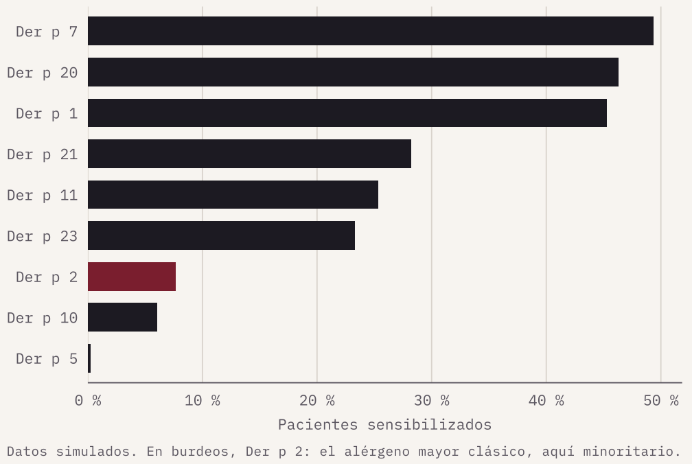
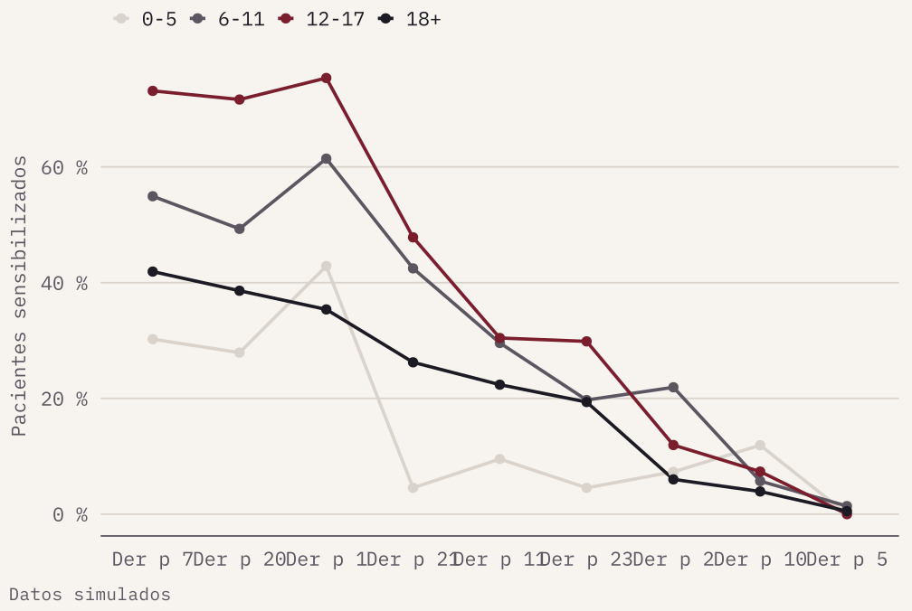
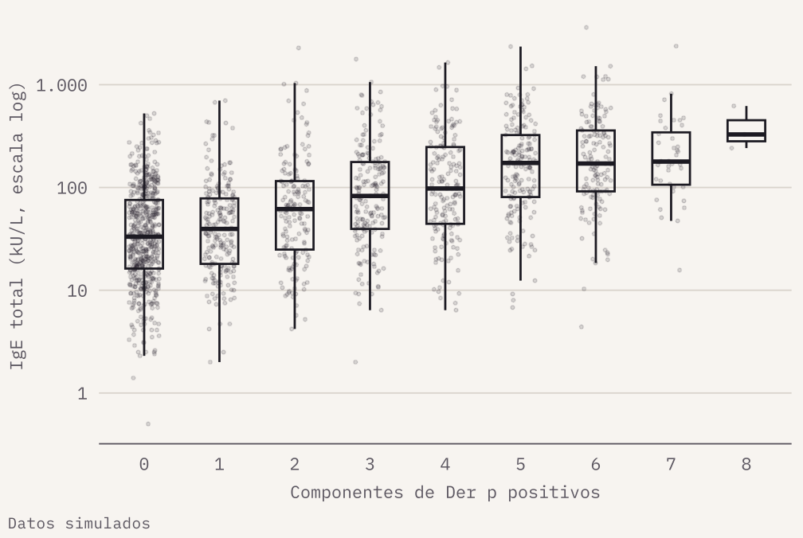
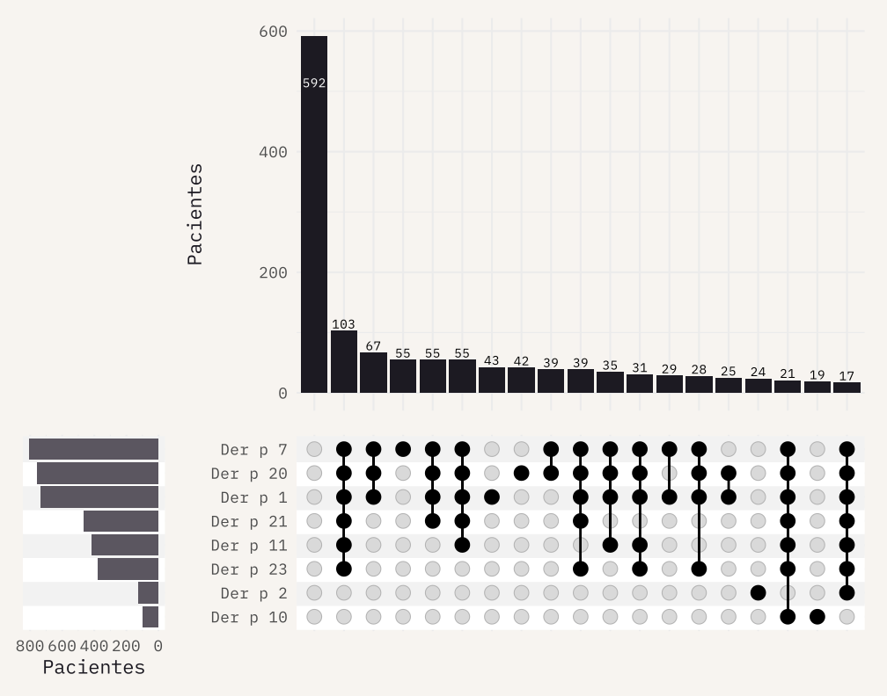
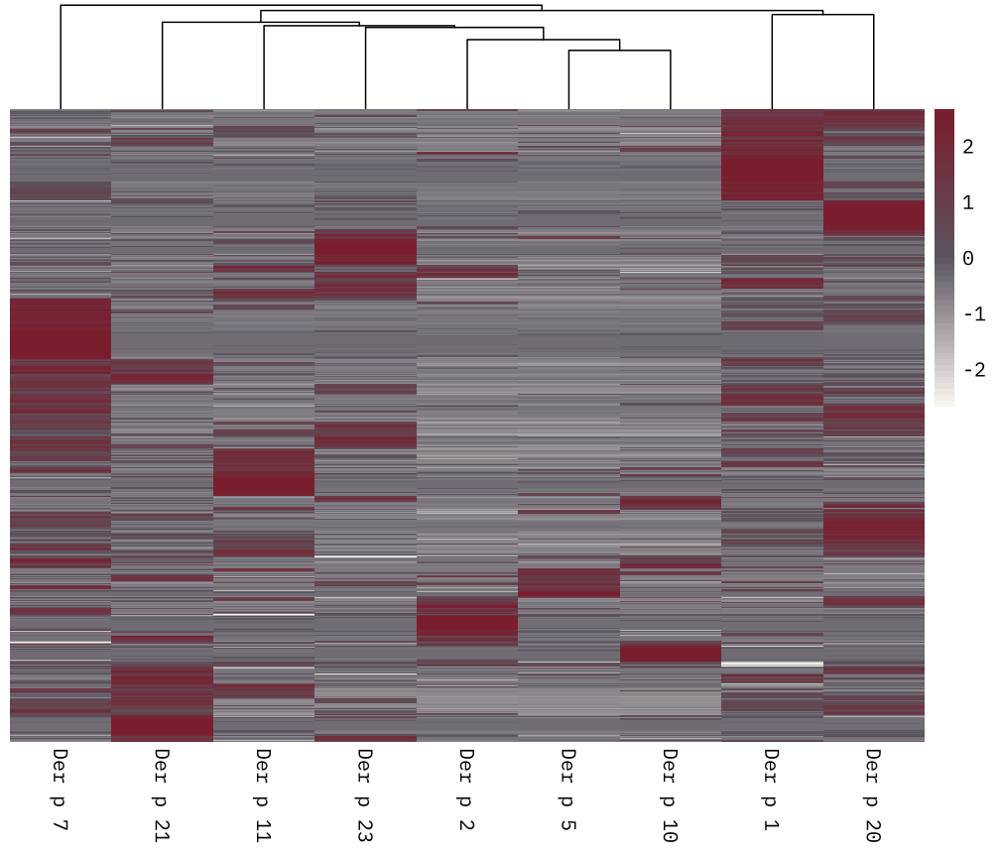
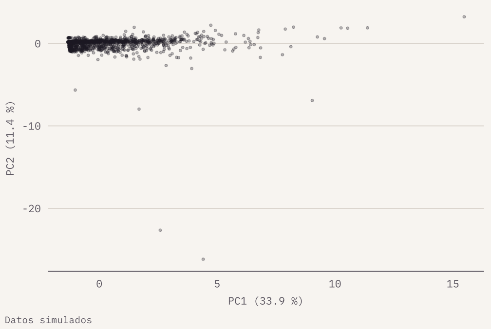
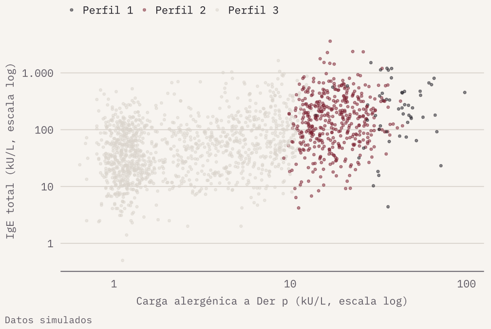

Sensibilización molecular a Der p (ácaro del polvo doméstico)
================

- [0. Cabecera](#0-cabecera)
- [1. Configuración](#1-configuración)
  - [Tamaño muestral](#tamaño-muestral)
- [2. Datos](#2-datos)
- [3. Descriptivos](#3-descriptivos)
- [4. Análisis principal](#4-análisis-principal)
  - [4.1. Prevalencia de sensibilización a cada
    componente](#41-prevalencia-de-sensibilización-a-cada-componente)
  - [4.2. Sensibilización por grupo de
    edad](#42-sensibilización-por-grupo-de-edad)
  - [4.3. IgE total y número de componentes
    positivos](#43-ige-total-y-número-de-componentes-positivos)
  - [4.4. IgE total y carga alergénica por
    edad](#44-ige-total-y-carga-alergénica-por-edad)
  - [4.5. IgE específica por edad, componente a
    componente](#45-ige-específica-por-edad-componente-a-componente)
- [5. Análisis secundarios: patrones de
  co-sensibilización](#5-análisis-secundarios-patrones-de-co-sensibilización)
  - [5.1. Combinaciones más frecuentes
    (UpSet)](#51-combinaciones-más-frecuentes-upset)
  - [5.2. Mapa de calor de la IgE
    específica](#52-mapa-de-calor-de-la-ige-específica)
  - [5.3. Análisis de componentes principales
    (PCA)](#53-análisis-de-componentes-principales-pca)
  - [5.4. Perfiles de pacientes
    (k-means)](#54-perfiles-de-pacientes-k-means)
- [6. Figuras](#6-figuras)
- [7. Información de la sesión](#7-información-de-la-sesión)

## 0. Cabecera

**Artículo:** Sensitization patterns to molecular allergens of house
dust mites (*Dermatophagoides pteronyssinus*) on the Canary Islands.
*Allergo J Int* 2025. <https://doi.org/10.1007/s40629-025-00349-5>

**Objetivo.** Describir el perfil de sensibilización a los componentes
moleculares de *D. pteronyssinus* (Der p): qué componentes predominan,
cómo cambian con la edad, cómo se agrupan entre sí y si hay perfiles de
pacientes diferenciados.

**Diseño.** Estudio observacional, retrospectivo y transversal.
Pacientes con sospecha de enfermedad alérgica estudiados con la
plataforma multiplex ALEX2.

**Variables principales**

| Variable               | Descripción                                                                                                                        |
|------------------------|------------------------------------------------------------------------------------------------------------------------------------|
| `id`                   | Identificador ficticio del paciente                                                                                                |
| `age`                  | Edad en años (vacía si no consta la fecha de nacimiento)                                                                           |
| `total_ige`            | IgE total (kU/L)                                                                                                                   |
| `der_p_1` … `der_p_23` | IgE específica (kU/L) frente a 9 componentes de Der p: 1, 2, 5, 7, 10, 11, 20, 21 y 23. Los valores “\< 0,10” se guardan como 0,10 |

> **Datos simulados.** Este repositorio no contiene datos de pacientes.
> El archivo `data/der_p_simulado.csv` lo genera `R/simular_datos.R` con
> la misma estructura que los datos reales y prevalencias parecidas a
> las publicadas. Las cifras se parecen, pero no son las del artículo.

## 1. Configuración

``` r
library(dplyr)
library(tidyr)
library(ggplot2)
library(pwr)           # precisión y diferencia mínima detectable
library(dunn.test)     # comparaciones post hoc tras Kruskal-Wallis
library(ComplexUpset)  # gráfico UpSet de co-sensibilización
library(pheatmap)      # mapa de calor

source("R/theme_pmenor.R")
usar_pmenor(base_size = 12, fondo = "papel")

set.seed(123)

ALLERGENS <- c("der_p_1", "der_p_2", "der_p_5", "der_p_7", "der_p_10",
               "der_p_11", "der_p_20", "der_p_21", "der_p_23")
ALLERGEN_LABELS <- setNames(sub("der_p_", "Der p ", ALLERGENS), ALLERGENS)

SENS_CUTOFF <- 0.35   # sensibilización: IgE específica >= 0,35 kU/L
AGE_BREAKS  <- c(-Inf, 5, 11, 17, Inf)
AGE_LABELS  <- c("0-5", "6-11", "12-17", "18+")
K_CLUSTERS  <- 3      # número de perfiles en el k-means
```

### Tamaño muestral

Al ser retrospectivo, no se calculó el tamaño muestral a priori. Lo que
sí se puede comprobar es qué permitía la muestra disponible, sin usar
los resultados obtenidos.

**Precisión.** ¿Con qué margen se estima una prevalencia baja, como la
de Der p 2 (en torno al 7 %), con 1.685 pacientes?

``` r
n_total <- 1685
p_low   <- 0.073
margin  <- qnorm(0.975) * sqrt(p_low * (1 - p_low) / n_total)
round(100 * margin, 1)   # margen de error del IC 95 %, en puntos porcentuales
```

    #> [1] 1.2

**Diferencia mínima detectable.** Con los tamaños de grupo de edad
disponibles, ¿qué diferencia se podía detectar con una potencia del 80
%? Es la forma honesta de responder a “¿daba la muestra para comparar
grupos?”: no depende del resultado observado.

``` r
# Proporción mínima detectable en un grupo pequeño frente a los adultos (n = 395),
# partiendo de una prevalencia en adultos del 5 %
detectable_p <- function(n_small, n_ref = 395, p_ref = 0.05) {
  h <- pwr.2p2n.test(n1 = n_small, n2 = n_ref, power = 0.80, sig.level = 0.05)$h
  sin(asin(sqrt(p_ref)) + h / 2)^2
}
round(100 * c("0-5 (n = 44)"   = detectable_p(44),
              "6-11 (n = 73)"  = detectable_p(73),
              "12-17 (n = 70)" = detectable_p(70)), 1)
```

    #>   0-5 (n = 44)  6-11 (n = 73) 12-17 (n = 70) 
    #>           18.8           15.5           15.7

``` r
# Correlación mínima detectable con toda la cohorte
round(pwr.r.test(n = n_total, power = 0.80, sig.level = 0.05)$r, 3)
```

    #> [1] 0.068

Con los grupos infantiles se detectan diferencias grandes (por ejemplo,
un 5 % en adultos frente a un 17-20 % en niños), pero no diferencias
pequeñas. Para la correlación, cualquier asociación mínimamente
relevante es detectable.

## 2. Datos

``` r
if (!file.exists("data/der_p_simulado.csv")) source("R/simular_datos.R")
der_p <- read.csv("data/der_p_simulado.csv")

der_p <- der_p |>
  mutate(
    age_group = cut(age, breaks = AGE_BREAKS, labels = AGE_LABELS),
    # Número de componentes positivos (los ausentes no cuentan)
    n_sens    = rowSums(across(all_of(ALLERGENS), \(x) x >= SENS_CUTOFF), na.rm = TRUE),
    any_sens  = n_sens >= 1,
    # Carga alergénica: suma de IgE específica a los 9 componentes
    der_p_load = rowSums(across(all_of(ALLERGENS)), na.rm = TRUE)
  )

glimpse(der_p)
```

    #> Rows: 1,685
    #> Columns: 16
    #> $ id         <chr> "P0001", "P0002", "P0003", "P0004", "P0005", "P0006", "P000…
    #> $ age        <int> NA, NA, NA, 30, 69, NA, NA, NA, NA, NA, NA, 86, NA, NA, NA,…
    #> $ total_ige  <dbl> 20.7, 60.7, 11.2, 563.1, 218.5, 16.8, 586.2, 134.5, 25.2, 4…
    #> $ der_p_1    <dbl> 0.10, 0.10, 0.34, 3.41, 1.11, 0.10, 0.10, 0.19, 1.70, 0.10,…
    #> $ der_p_2    <dbl> 0.33, 0.20, 0.10, 0.26, 0.10, 0.30, NA, 0.10, 0.16, 0.10, 0…
    #> $ der_p_5    <dbl> 0.10, 0.10, 0.33, 0.10, 0.10, 0.10, 0.25, 0.14, 0.10, 0.15,…
    #> $ der_p_7    <dbl> 0.95, 0.10, 0.10, 0.23, 2.74, 0.15, NA, 1.17, 0.15, 0.26, 0…
    #> $ der_p_10   <dbl> 0.10, 0.10, 0.10, 0.10, 4.79, 0.33, 0.10, 0.15, 0.10, 0.10,…
    #> $ der_p_11   <dbl> 0.10, NA, 1.15, 4.19, 0.32, 0.10, 0.10, 0.10, 0.10, 0.10, 0…
    #> $ der_p_20   <dbl> 0.10, 0.11, 0.10, 2.29, 3.79, 0.10, 1.07, 0.10, 0.18, 0.19,…
    #> $ der_p_21   <dbl> 2.40, 0.10, 0.10, 0.10, 0.10, 0.29, 3.76, 0.10, 0.10, 0.10,…
    #> $ der_p_23   <dbl> 0.10, 0.10, 0.10, 1.24, 0.10, 0.10, 13.57, 0.10, 0.32, 0.14…
    #> $ age_group  <fct> NA, NA, NA, 18+, 18+, NA, NA, NA, NA, NA, NA, 18+, NA, NA, …
    #> $ n_sens     <dbl> 2, 0, 1, 4, 4, 0, 3, 1, 1, 0, 0, 0, 4, 3, 4, 0, 0, 3, 4, 0,…
    #> $ any_sens   <lgl> TRUE, FALSE, TRUE, TRUE, TRUE, FALSE, TRUE, TRUE, TRUE, FAL…
    #> $ der_p_load <dbl> 4.28, 0.91, 2.42, 11.92, 13.15, 1.57, 18.95, 2.15, 2.91, 1.…

La edad solo consta en una parte de los pacientes. Los análisis por edad
usan esos pacientes; el resto, la cohorte completa.

``` r
der_p |>
  summarise(total = n(), with_age = sum(!is.na(age)), without_age = sum(is.na(age)))
```

    #>   total with_age without_age
    #> 1  1685      582        1103

``` r
table(der_p$age_group, useNA = "ifany")
```

    #> 
    #>   0-5  6-11 12-17   18+  <NA> 
    #>    44    73    70   395  1103

## 3. Descriptivos

``` r
der_p |>
  summarise(
    n                = n(),
    age_median       = median(age, na.rm = TRUE),
    total_ige_median = median(total_ige),
    total_ige_q1     = quantile(total_ige, 0.25),
    total_ige_q3     = quantile(total_ige, 0.75),
    any_sens_pct     = round(100 * mean(any_sens), 1),
    n_sens_range     = paste(range(n_sens), collapse = "-")
  )
```

    #>      n age_median total_ige_median total_ige_q1 total_ige_q3 any_sens_pct
    #> 1 1685       36.5               62         25.2          150         64.9
    #>   n_sens_range
    #> 1          0-8

## 4. Análisis principal

### 4.1. Prevalencia de sensibilización a cada componente

Para cada componente, el denominador son los pacientes con ese
componente medido (los valores ausentes no cuentan como negativos).

``` r
prev_overall <- der_p |>
  pivot_longer(all_of(ALLERGENS), names_to = "allergen", values_to = "ige") |>
  filter(!is.na(ige)) |>
  group_by(allergen) |>
  summarise(n = n(), positives = sum(ige >= SENS_CUTOFF),
            prevalence = 100 * positives / n, .groups = "drop") |>
  mutate(allergen = ALLERGEN_LABELS[allergen]) |>
  arrange(desc(prevalence))

prev_overall |> mutate(prevalence = round(prevalence, 1))
```

    #> # A tibble: 9 × 4
    #>   allergen     n positives prevalence
    #>   <chr>    <int>     <int>      <dbl>
    #> 1 Der p 7   1630       805       49.4
    #> 2 Der p 20  1636       758       46.3
    #> 3 Der p 1   1625       736       45.3
    #> 4 Der p 21  1645       464       28.2
    #> 5 Der p 11  1636       415       25.4
    #> 6 Der p 23  1628       379       23.3
    #> 7 Der p 2   1639       126        7.7
    #> 8 Der p 10  1633        99        6.1
    #> 9 Der p 5   1639         4        0.2

``` r
ggplot(prev_overall, aes(reorder(allergen, prevalence), prevalence)) +
  geom_col(width = 0.7) +
  geom_col(data = \(d) filter(d, allergen == "Der p 2"),
           fill = pmenor_col[["burdeos"]], width = 0.7) +
  coord_flip() +
  scale_y_continuous(labels = \(x) paste0(x, " %"), expand = expansion(c(0, 0.05))) +
  labs(x = NULL, y = "Pacientes sensibilizados",
       caption = "Datos simulados. En burdeos, Der p 2: el alérgeno mayor clásico, aquí minoritario.") +
  theme(panel.grid.major.y = element_blank(),
        panel.grid.major.x = element_line(colour = pmenor_col[["linea"]]))
```

<figure>

<figcaption aria-hidden="true">Prevalencia de sensibilización a cada
componente de Der p.</figcaption>
</figure>

### 4.2. Sensibilización por grupo de edad

``` r
by_age <- der_p |>
  filter(!is.na(age_group)) |>
  pivot_longer(all_of(ALLERGENS), names_to = "allergen", values_to = "ige") |>
  filter(!is.na(ige)) |>
  group_by(age_group, allergen) |>
  summarise(prevalence = 100 * mean(ige >= SENS_CUTOFF), .groups = "drop") |>
  mutate(allergen = factor(ALLERGEN_LABELS[allergen],
                           levels = prev_overall$allergen))  # mismo orden que 4.1

by_age |>
  mutate(prevalence = round(prevalence, 1)) |>
  pivot_wider(names_from = age_group, values_from = prevalence)
```

    #> # A tibble: 9 × 5
    #>   allergen `0-5` `6-11` `12-17` `18+`
    #>   <fct>    <dbl>  <dbl>   <dbl> <dbl>
    #> 1 Der p 1   42.9   61.4    75.4  35.4
    #> 2 Der p 10  11.9    5.7     7.4   3.9
    #> 3 Der p 11   9.5   29.6    30.4  22.4
    #> 4 Der p 2    7.3   21.9    11.9   6  
    #> 5 Der p 20  27.9   49.3    71.6  38.6
    #> 6 Der p 21   4.5   42.5    47.8  26.2
    #> 7 Der p 23   4.5   19.7    29.9  19.4
    #> 8 Der p 5    0      1.4     0     0.5
    #> 9 Der p 7   30.2   54.9    73.1  41.9

``` r
ggplot(by_age, aes(allergen, prevalence, colour = age_group, group = age_group)) +
  geom_line() +
  geom_point(size = 2) +
  scale_colour_manual(values = c("0-5" = pmenor_col[["linea"]], "6-11" = pmenor_col[["gris"]],
                                 "12-17" = pmenor_col[["burdeos"]], "18+" = pmenor_col[["tinta"]])) +
  scale_y_continuous(labels = \(x) paste0(x, " %")) +
  labs(x = NULL, y = "Pacientes sensibilizados", caption = "Datos simulados")
```

<figure>

<figcaption aria-hidden="true">Prevalencia de sensibilización por grupo
de edad.</figcaption>
</figure>

¿Cambia la prevalencia con la edad? Un test por componente: χ² o, si
alguna frecuencia esperada es menor de 5, exacto de Fisher.

``` r
test_age <- function(allergen) {
  d   <- der_p |> filter(!is.na(age_group), !is.na(.data[[allergen]]))
  tab <- table(d[[allergen]] >= SENS_CUTOFF, d$age_group)
  expected <- suppressWarnings(chisq.test(tab)$expected)
  if (any(expected < 5)) {
    data.frame(test = "Fisher", p = fisher.test(tab)$p.value)
  } else {
    data.frame(test = "Chi-squared", p = chisq.test(tab)$p.value)
  }
}

age_tests <- bind_rows(lapply(ALLERGENS, test_age)) |>
  mutate(allergen = ALLERGEN_LABELS[ALLERGENS],
         p = signif(p, 2)) |>
  select(allergen, test, p)
age_tests
```

    #>   allergen        test       p
    #> 1  Der p 1 Chi-squared 2.7e-10
    #> 2  Der p 2      Fisher 4.4e-04
    #> 3  Der p 5      Fisher 6.9e-01
    #> 4  Der p 7 Chi-squared 2.3e-06
    #> 5 Der p 10      Fisher 9.8e-02
    #> 6 Der p 11 Chi-squared 4.3e-02
    #> 7 Der p 20 Chi-squared 1.0e-06
    #> 8 Der p 21 Chi-squared 4.4e-07
    #> 9 Der p 23 Chi-squared 1.3e-02

### 4.3. IgE total y número de componentes positivos

La IgE total es muy asimétrica, así que se compara con tests no
paramétricos y se dibuja en escala logarítmica.

``` r
cor.test(der_p$total_ige, der_p$n_sens, method = "spearman", exact = FALSE)
```

    #> 
    #>  Spearman's rank correlation rho
    #> 
    #> data:  der_p$total_ige and der_p$n_sens
    #> S = 406303701, p-value < 2.2e-16
    #> alternative hypothesis: true rho is not equal to 0
    #> sample estimates:
    #>       rho 
    #> 0.4904316

``` r
ggplot(der_p, aes(factor(n_sens), total_ige)) +
  geom_jitter(width = 0.2, alpha = 0.15, size = 0.8) +
  geom_boxplot(outlier.shape = NA, width = 0.5, linewidth = grosor_pmenor(3)) +
  scale_y_log10(labels = numeros_pmenor()) +
  labs(x = "Componentes de Der p positivos", y = "IgE total (kU/L, escala log)",
       caption = "Datos simulados")
```

<figure>

<figcaption aria-hidden="true">IgE total según el número de componentes
de Der p positivos.</figcaption>
</figure>

### 4.4. IgE total y carga alergénica por edad

Kruskal-Wallis para comparar los cuatro grupos y, si hay diferencias,
Dunn con ajuste de Bonferroni para ver entre qué grupos están.

``` r
der_p_age <- der_p |> filter(!is.na(age_group))

# IgE total
kruskal.test(total_ige ~ age_group, data = der_p_age)
```

    #> 
    #>  Kruskal-Wallis rank sum test
    #> 
    #> data:  total_ige by age_group
    #> Kruskal-Wallis chi-squared = 52.793, df = 3, p-value = 2.03e-11

``` r
# Carga alergénica total a Der p (suma de los 9 componentes)
kruskal.test(der_p_load ~ age_group, data = der_p_age)
```

    #> 
    #>  Kruskal-Wallis rank sum test
    #> 
    #> data:  der_p_load by age_group
    #> Kruskal-Wallis chi-squared = 24.428, df = 3, p-value = 2.033e-05

``` r
# dunn.test() escribe su propia tabla en consola; se recoge el resultado en un data frame
dunn_table <- function(x, g) {
  invisible(capture.output(
    dn <- dunn.test(x, g, method = "bonferroni", kw = FALSE, table = FALSE)
  ))
  data.frame(comparison = dn$comparisons, z = round(dn$Z, 2),
             p_adjusted = signif(dn$P.adjusted, 2))
}
dunn_table(der_p_age$der_p_load, der_p_age$age_group)
```

    #>     comparison     z p_adjusted
    #> 1   0-5 - 6-11 -2.33    0.06000
    #> 2  0-5 - 12-17 -3.79    0.00045
    #> 3 6-11 - 12-17 -1.71    0.26000
    #> 4    0-5 - 18+ -1.04    0.89000
    #> 5   6-11 - 18+  2.19    0.08500
    #> 6  12-17 - 18+  4.35    0.00004

### 4.5. IgE específica por edad, componente a componente

``` r
age_sige <- lapply(ALLERGENS, function(a) {
  d  <- der_p_age |> filter(!is.na(.data[[a]]))
  kw <- kruskal.test(d[[a]] ~ d$age_group)
  # Comparación de interés del artículo: adolescentes (12-17) frente a 0-5 años
  dn <- dunn_table(d[[a]], d$age_group)
  data.frame(allergen = ALLERGEN_LABELS[[a]],
             p_kruskal = signif(kw$p.value, 2),
             p_12_17_vs_0_5 = dn$p_adjusted[dn$comparison == "0-5 - 12-17"])
})
bind_rows(age_sige)
```

    #>   allergen p_kruskal p_12_17_vs_0_5
    #> 1  Der p 1   5.3e-06        0.01300
    #> 2  Der p 2   1.6e-01        1.00000
    #> 3  Der p 5   2.0e-01        1.00000
    #> 4  Der p 7   1.5e-03        0.00180
    #> 5 Der p 10   1.6e-01        1.00000
    #> 6 Der p 11   1.2e-01        0.10000
    #> 7 Der p 20   2.0e-04        0.00180
    #> 8 Der p 21   4.2e-04        0.00068
    #> 9 Der p 23   5.1e-02        0.01700

## 5. Análisis secundarios: patrones de co-sensibilización

### 5.1. Combinaciones más frecuentes (UpSet)

``` r
binary <- der_p |>
  mutate(across(all_of(ALLERGENS), \(x) !is.na(x) & x >= SENS_CUTOFF)) |>
  select(all_of(ALLERGENS)) |>
  rename_with(\(x) ALLERGEN_LABELS[x])

upset(binary, intersect = unname(ALLERGEN_LABELS), name = NULL, min_size = 15,
      base_annotations = list("Pacientes" = intersection_size(
        fill = pmenor_col[["tinta"]], text = list(size = 2.5))),
      set_sizes = upset_set_size(geom = geom_bar(fill = pmenor_col[["gris"]])) +
        ylab("Pacientes"),
      width_ratio = 0.2,
      themes = upset_default_themes(text = element_text(family = "IBM Plex Mono",
                                                        colour = pmenor_col[["tinta"]])))
```

<figure>

<figcaption aria-hidden="true">Combinaciones de componentes positivos
más frecuentes.</figcaption>
</figure>

### 5.2. Mapa de calor de la IgE específica

Cada fila es un paciente, escalado por filas: muestra qué componentes
pesan más en cada paciente, no el nivel absoluto.

``` r
heat <- der_p |>
  select(all_of(ALLERGENS)) |>
  mutate(across(everything(), \(x) coalesce(x, 0))) |>
  rename_with(\(x) ALLERGEN_LABELS[x]) |>
  as.matrix()
heat <- heat[apply(heat, 1, sd) > 0, ]   # sin variación no se puede escalar

pheatmap(heat, scale = "row", show_rownames = FALSE, treeheight_row = 0,
         color = colorRampPalette(c(pmenor_col[["papel"]], pmenor_col[["gris"]],
                                    pmenor_col[["burdeos"]]))(50),
         border_color = NA, fontfamily = "IBM Plex Mono")
```

<figure>

<figcaption aria-hidden="true">IgE específica a los componentes de Der p
(escalada por paciente).</figcaption>
</figure>

### 5.3. Análisis de componentes principales (PCA)

Sobre la IgE específica estandarizada. Los ausentes se tratan como 0.

``` r
derp_matrix <- der_p |>
  select(all_of(ALLERGENS)) |>
  mutate(across(everything(), \(x) coalesce(x, 0)))

pca <- prcomp(derp_matrix, scale. = TRUE)
summary(pca)$importance[, 1:3]
```

    #>                             PC1      PC2       PC3
    #> Standard deviation     1.747528 1.012509 0.9841541
    #> Proportion of Variance 0.339320 0.113910 0.1076200
    #> Cumulative Proportion  0.339320 0.453230 0.5608400

``` r
# Qué componentes de Der p pesan más en los dos primeros ejes
round(pca$rotation[, 1:2], 2)
```

    #>           PC1   PC2
    #> der_p_1  0.37 -0.02
    #> der_p_2  0.16 -0.32
    #> der_p_5  0.04 -0.92
    #> der_p_7  0.43  0.10
    #> der_p_10 0.22  0.17
    #> der_p_11 0.40 -0.05
    #> der_p_20 0.40 -0.03
    #> der_p_21 0.38  0.03
    #> der_p_23 0.37  0.09

``` r
var_pc <- round(100 * summary(pca)$importance[2, 1:2], 1)
ggplot(as.data.frame(pca$x), aes(PC1, PC2)) +
  geom_point(alpha = 0.3, size = 1) +
  labs(x = paste0("PC1 (", var_pc[1], " %)"), y = paste0("PC2 (", var_pc[2], " %)"),
       caption = "Datos simulados")
```

<figure>

<figcaption aria-hidden="true">PCA de los perfiles de
sensibilización.</figcaption>
</figure>

### 5.4. Perfiles de pacientes (k-means)

k-means con 3 grupos sobre la misma matriz estandarizada.

``` r
set.seed(123)   # k-means parte de centros aleatorios: semilla fija para reproducirlo
km <- kmeans(scale(derp_matrix), centers = K_CLUSTERS)
der_p$cluster <- factor(paste("Perfil", km$cluster))

# Perfil de cada grupo: tamaño, IgE total y componentes positivos
der_p |>
  group_by(cluster) |>
  summarise(n = n(), total_ige_median = median(total_ige),
            n_sens_median = median(n_sens),
            der_p_load_median = round(median(der_p_load), 1))
```

    #> # A tibble: 3 × 5
    #>   cluster      n total_ige_median n_sens_median der_p_load_median
    #>   <fct>    <int>            <dbl>         <dbl>             <dbl>
    #> 1 Perfil 1    53            242.              6              37.6
    #> 2 Perfil 2   427            151.              5              17.3
    #> 3 Perfil 3  1205             45.8             1               1.7

``` r
# Distribución por edad (solo pacientes con edad registrada)
cluster_age <- table(der_p$cluster, der_p$age_group)
cluster_age
```

    #>           
    #>            0-5 6-11 12-17 18+
    #>   Perfil 1   1    2     3  13
    #>   Perfil 2   6   19    27  85
    #>   Perfil 3  37   52    40 297

``` r
round(100 * prop.table(cluster_age, margin = 2), 1)   # % dentro de cada grupo de edad
```

    #>           
    #>             0-5 6-11 12-17  18+
    #>   Perfil 1  2.3  2.7   4.3  3.3
    #>   Perfil 2 13.6 26.0  38.6 21.5
    #>   Perfil 3 84.1 71.2  57.1 75.2

``` r
chisq.test(cluster_age)
```

    #> 
    #>  Pearson's Chi-squared test
    #> 
    #> data:  cluster_age
    #> X-squared = 13.279, df = 6, p-value = 0.03881

``` r
ggplot(filter(der_p, der_p_load > 0), aes(der_p_load, total_ige, colour = cluster)) +
  geom_point(alpha = 0.5, size = 1) +
  scale_colour_manual(values = c(pmenor_col[["tinta"]], pmenor_col[["burdeos"]],
                                 pmenor_col[["linea"]])) +
  scale_x_log10(labels = numeros_pmenor()) +
  scale_y_log10(labels = numeros_pmenor()) +
  labs(x = "Carga alergénica a Der p (kU/L, escala log)",
       y = "IgE total (kU/L, escala log)", caption = "Datos simulados")
```

<figure>

<figcaption aria-hidden="true">Perfiles de k-means según carga
alergénica a Der p e IgE total.</figcaption>
</figure>

## 6. Figuras

Las figuras se guardan en `output/` al ejecutar el documento (secciones
4 y 5).

## 7. Información de la sesión

``` r
sessionInfo()
```

    #> R version 4.3.3 (2024-02-29)
    #> Platform: x86_64-pc-linux-gnu (64-bit)
    #> Running under: Ubuntu 24.04.5 LTS
    #> 
    #> Matrix products: default
    #> BLAS:   /usr/lib/x86_64-linux-gnu/blas/libblas.so.3.12.0 
    #> LAPACK: /usr/lib/x86_64-linux-gnu/lapack/liblapack.so.3.12.0
    #> 
    #> locale:
    #>  [1] LC_CTYPE=C.UTF-8       LC_NUMERIC=C           LC_TIME=C.UTF-8       
    #>  [4] LC_COLLATE=C.UTF-8     LC_MONETARY=C.UTF-8    LC_MESSAGES=C.UTF-8   
    #>  [7] LC_PAPER=C.UTF-8       LC_NAME=C              LC_ADDRESS=C          
    #> [10] LC_TELEPHONE=C         LC_MEASUREMENT=C.UTF-8 LC_IDENTIFICATION=C   
    #> 
    #> time zone: Atlantic/Canary
    #> tzcode source: system (glibc)
    #> 
    #> attached base packages:
    #> [1] stats     graphics  grDevices utils     datasets  methods   base     
    #> 
    #> other attached packages:
    #> [1] pheatmap_1.0.12    ComplexUpset_1.3.3 dunn.test_1.4.2    pwr_1.3-0         
    #> [5] ggplot2_3.4.4      tidyr_1.3.1        dplyr_1.1.4       
    #> 
    #> loaded via a namespace (and not attached):
    #>  [1] gtable_0.3.4       highr_0.10         compiler_4.3.3     tidyselect_1.2.0  
    #>  [5] systemfonts_1.0.5  scales_1.3.0       yaml_2.3.8         fastmap_1.1.1     
    #>  [9] R6_2.5.1           labeling_0.4.3     generics_0.1.3     patchwork_1.2.0   
    #> [13] knitr_1.45         tibble_3.2.1       munsell_0.5.0      pillar_1.9.0      
    #> [17] RColorBrewer_1.1-3 rlang_1.1.3        utf8_1.2.4         xfun_0.41         
    #> [21] cli_3.6.2          withr_2.5.0        magrittr_2.0.3     digest_0.6.34     
    #> [25] grid_4.3.3         lifecycle_1.0.4    vctrs_0.6.5        evaluate_0.23     
    #> [29] glue_1.7.0         farver_2.1.1       fansi_1.0.5        colorspace_2.1-0  
    #> [33] rmarkdown_2.25     purrr_1.0.2        tools_4.3.3        pkgconfig_2.0.3   
    #> [37] htmltools_0.5.7
